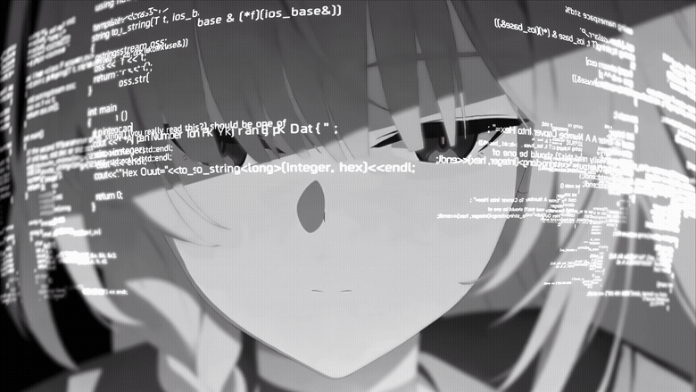

# Hi, I'm Zadwen

I'm a cybersecurity student interested in **Linux, CTFs, and security research**. I build tools that simplify setup, investigation, and everyday computing.

Most of my projects use **Python and shell scripting**. My interests include network analysis, digital forensics, reverse engineering, Linux automation, and practical applications of AI.

## Featured projects

| Project | What it does |
| --- | --- |
| [Cyber Toolkit](https://github.com/zadwen/cyber-toolkit) | Profile-based Linux installer for cybersecurity students, CTF players, defenders, and AI students. |
| [CTF Assistant](https://github.com/zadwen/ctf-assistant) | Utilities for working through capture-the-flag challenges. |
| [Leakwatch](https://github.com/zadwen/leakwatch) | Privacy and security monitoring tools for Linux. |
| [Linux APK Runner](https://github.com/zadwen/linux-apk-runner) | Desktop launcher and emulator setup for running Android APKs on Linux. |
| [FocusLock](https://github.com/zadwen/FocusLock) | An app blocker designed to help with studying and focus. |
| [Gameify](https://github.com/zadwen/gameify) | Linux gaming setup and configuration automation. |

## What I'm working on

- Making Linux installers easier to use, with clear dependencies and useful failure reports.
- Building and improving tools for cybersecurity learning and CTF practice.
- Adding tests, documentation, and clearer limitations to my projects.

## More projects

[InfoHawk](https://github.com/zadwen/InfoHawk) · [Reaper](https://github.com/zadwen/Reaper) · [Proton Tune](https://github.com/zadwen/proton-tune) · [Salah App](https://github.com/zadwen/salah-app)

My repositories include learning projects and experimental tools. Check each project's README for supported systems, setup instructions, and current limitations.

Questions or bug reports? Open an issue in the relevant repository.
